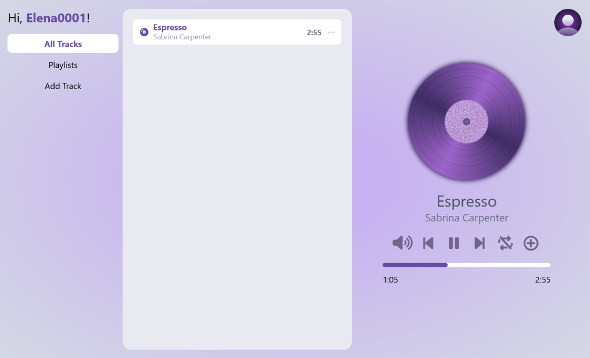
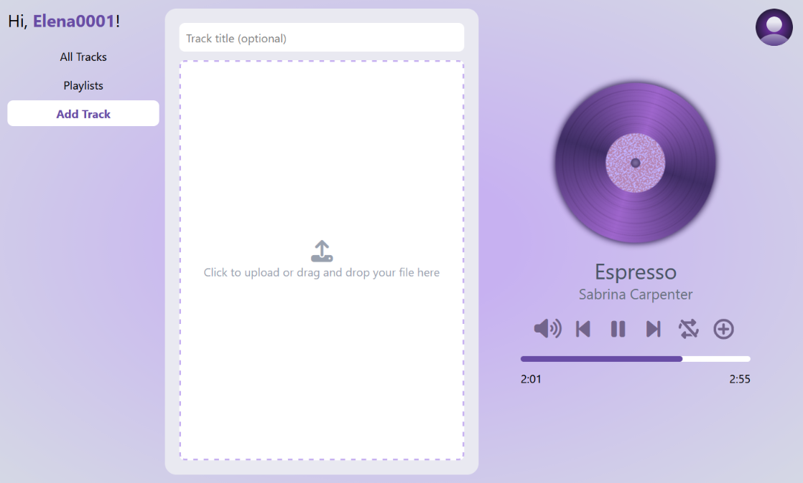

# Music Player

A full-stack web application for managing and playing a personal music library. Users can upload audio files, organize tracks into playlists, and listen to music using an interactive audio player.

## Screenshots

## Features

- **User Authentication** - register and log in to your account.
- **Music Library** - upload, view, edit and delete tracks.
- **Playlist Management** - create and delete playlists, add or remove tracks.
- **Audio Player** - play and pause music, skip between tracks and control playback progress.
- **Repeat Modes** - choose whether to repeat the current track or the playlist.

## Tech Stack

### Frontend

- React
- JavaScript
- React Router
- React Context API
- Tailwind CSS
- Axios

### Backend

- Python
- Django
- Django REST Framework
- SQLite
